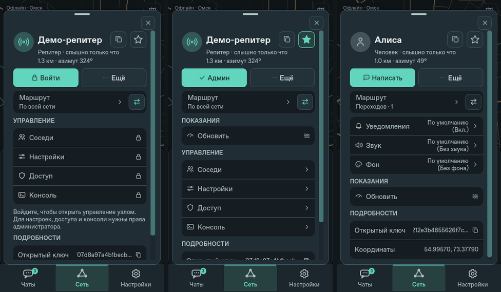

# OMMesh Belle 0.2.19

Неофициальный нативный клиент MeshCore для **Nokia с Symbian Belle**. Приложение подключается к ноде по Wi‑Fi и TCP, показывает личные чаты, каналы и карту сети. Навигация **Чаты · Сеть · Настройки** следует мобильному OMMesh. Порт рассчитан на сенсорный экран 360×640 и в первую очередь на Nokia 700. [Исходный проект OMMesh](https://github.com/cm4ker/ommesh)

**Тестовый выпуск.** Версия 0.2.19 расширяет карточки узлов. У репитера есть вход, маршрут, соседи, настройки, доступ и консоль. До 400 последних сообщений каждой ноды сохраняются на телефоне и доступны без подключения.

## Совместимость

В EKA2L1 на образе Nokia X7 проверены установка 0.2.19, раздел «Сеть», фильтры и полноэкранная карта. Карточки человека и репитера проверены там же в сборке с тестовыми узлами. Остальные проверки в таблице проводились со сборкой 0.2.17.

| Модель | Прошивка | Результат |
| --- | --- | --- |
| **Nokia 700 (RM‑670)** | Nokia Belle | Целевая модель. На физическом телефоне пробовали более ранние сборки. Версия 0.2.19 требует проверки на устройстве. |
| **Nokia X7 (RM‑707)** | Belle Refresh `111.040.1511`, Qt 4.8.0 | Работают запуск, переход в «Сеть», фильтры и раскрытие карты в 0.2.19. |
| **Nokia C7 (RM‑675)** | Belle `111.030.0609`, Qt 4.7.4 | Открывается экран «Чаты». Остальные функции на этой версии Qt требуют проверки. |
| **Nokia E6 (RM‑609)** | Belle Refresh `111.140.0058` | Открывается экран «Чаты» в горизонтальном режиме 640×480. |
| **Nokia 808 PureView (RM‑807)** | Delight на базе Belle FP2 `113.010.1508` | Пакет установился, журнал подтвердил запуск процесса. В эмуляторе остался чёрный экран. Работу этой версии на штатной прошивке и физическом устройстве нужно проверить отдельно. |

**Кандидаты для проверки** — Nokia 701 и 603 с Belle Feature Pack 1 или 2. Для Nokia N8, E7, C6‑01, Oro и 500 подходящий вариант для проверки — Belle Refresh. Совместимость зависит от конкретной прошивки и её системных библиотек. [Список обновлений Belle FP1](https://blogs.windows.com/devices/2012/03/01/all-about-nokia-belle-feature-pack-1/) · [Список обновлений Belle Refresh](https://learn.microsoft.com/en-us/answers/questions/2518149/nokia-belle-refresh-update-just-launched) · [Версии Qt для Symbian](https://wiki.qt.io/Support_for_Symbian)

На каждом физическом телефоне отдельно предстоит проверить отправку через MeshCore, восстановление Wi‑Fi и вибрацию. Для проверки интерфейса без ноды есть встроенный режим «Демо».

## Установка и подключение

[Релиз OMMesh Belle 0.2.19](https://github.com/AVA55LV/ommesh/releases/tag/belle-v0.2.19)

1. Скопируйте подписанный файл **OMMeshBelle-Nokia700-0.2.19-test.sis** на телефон. Откройте его в файловом менеджере и запустите OMMesh Belle из меню приложений. Пакет самоподписанный и обновляет предыдущую нативную установку.
2. Подключите телефон и рацию с прошивкой **MeshCore Companion Wi-Fi** к одной локальной сети. Откройте **Настройки → Подключение**, введите IP-адрес рации и TCP-порт (обычно **5000**). Если рация уже открыта в другом клиенте, завершите там сеанс.
3. Нажмите **Подключить**, дождитесь загрузки и выберите чат. Для знакомства с приложением без рации откройте **Настройки → Дополнительно → Демо**.

Чтобы при обрыве Nokia запрашивала соединение с Wi‑Fi, подключитесь к сохранённой точке доступа, затем в **Настройки → Подключение** включите **Автоподключение** и **Восстанавливать Wi‑Fi**. Belle получит запрос открыть сохранённую точку доступа. Работа зависит от доступности сети и системных настроек WLAN. Интернет для переписки по Wi‑Fi не требуется.

Для локального соединения вне дома телефон и нода могут подключиться к обычной точке доступа 2,4 ГГц с разрешённым обменом между клиентами. JoikuSpot на Symbian создаёт сеть ad-hoc. Штатная прошивка MeshCore Companion на ESP32 подключается в режиме станции к обычной точке доступа. На совместимой Wi‑Fi-сборке адрес ноды можно узнать через `get wifi.ip` и ввести в **Настройки → Подключение** с портом `5000`. [Код MeshCore Companion Wi-Fi](https://github.com/meshcore-dev/MeshCore/blob/companion-v1.18.0/examples/companion_radio/main.cpp#L213-L251)

При работе с рацией, которая поддерживает только BLE, понадобится отдельное устройство с BLE GATT. В Nokia 700 установлен Bluetooth 3.0. [Инструкция для моста](bridge/README.md)

## Чаты, сеть и настройки

- **Чаты** показывают последнее сообщение, время и число непрочитанных. Кнопка **+** открывает поиск по услышанным контактам и каналам. Действие **Добавить канал** использует свободный слот. Для открытого канала достаточно `#имени`, для закрытого нужен 32-значный шестнадцатеричный ключ. Public закреплён по умолчанию.
- Коснитесь сообщения, чтобы ответить с цитатой, посмотреть путь или повторить отправку. Удерживайте сообщение, чтобы поставить, изменить или снять реакцию. В меню есть быстрые реакции и полный выбор из 60 смайликов. Формат реакций сверён с Android OMMesh. Передача через канал требует поддержки пакетных данных прошивкой рации.
- У исходящего сообщения отображается анимация ожидания. Одна галочка означает, что нода приняла команду отправки. Две означают подтверждение доставки личного сообщения или приём повторов канального пакета в эфире. Для канала после галочек видно число услышанных первых репитеров, до 20. В подробностях сообщения тот же индикатор дополняют сведения о маршруте.
- После отправки чат показывает новое сообщение. При возврате к старой переписке подтверждения и повторы пакетов сохраняют место чтения. В **Настройки → Оформление** можно выбрать тему и настроить текст чата от 12 до 22 пикселей. Предпросмотр обновляется сразу.
- **Сеть** показывает карту и список узлов. Поиск по имени или ключу и фильтры справа от него применяются к обоим. Доступны типы узлов, избранное, своя нода и узлы с действующим входом, скрытие молчащих и сортировка по времени, имени, расстоянию или числу переходов. Сортировка по расстоянию использует координаты подключённой ноды.
- Нажатие на строку или отметку карты открывает карточку узла. В ней доступны избранное, копирование открытого ключа, маршрут и координаты. Отсюда можно открыть чат, найти узел на карте или войти в консоль репитера либо комнаты.
- Карточка **MeshCore Нода** показывает имя и состояние подключения. В **Настройки → Уведомления** доступны режим «Не беспокоить», вибрация по типу чата и её проверка. Консоль и редактор слотов находятся в разделе **Дополнительно**. Удаление канала из слота требует подтверждения.
- При потере связи с включённым автоподключением над заголовком настроек видна текущая попытка. «Попробовать сейчас» запускает её без ожидания, когда приложение ждёт следующего подключения. «Отключить» останавливает переподключение. Карточка сохраняет имя и последнее полученное напряжение этой ноды. Процент заряда оценивается по напряжению одного литий-ионного элемента.
- В **Настройки → Сообщения и маршруты** можно включить переход к первому непрочитанному, настроить замену букв и восстановление кириллицы, разблокировать отправителей и выбрать число попыток отправки в личном чате от 1 до 8. По умолчанию используется 5 попыток. После первой попытки по известному маршруту автоматические повторы идут по сети. Повтор в комнате выполняется вручную.
- Превью ссылок по умолчанию выключены. Выберите «По нажатию» или «Сразу», чтобы запрашивать заголовок и описание ссылки у `preview.ommesh.ru` по HTTPS. На сервер передаётся адрес ссылки. Для просмотра превью телефону нужен интернет.

Сеанс проверяет очередь сообщений раз в пять секунд. Журнал и история нативной сборки хранятся отдельно от Java-версии. Журналы консолей и пароли остаются в памяти на время сеанса.

**Каналы ноды** — групповые чаты MeshCore. Пункт **Настройки → Дополнительно → Каналы ноды** показывает занятые и свободные слоты в памяти подключённой ноды. Public — общий канал MeshCore. Чтобы подключить открытый канал, в **Чаты → + → Добавить канал** выберите свободный слот, введите `#имя` и оставьте поле ключа пустым. Для закрытого канала у участников должен совпадать 32-значный шестнадцатеричный ключ.

## Карта

В **Настройки → Дополнительно → Карты** доступны **Офлайн** и **OpenStreetMap · localhost**. Выберите второй пункт и нажмите **Готово**, чтобы получать плитки с `tile.openstreetmap.org` через прокси на `127.0.0.1`. Прокси работает внутри приложения и использует интернет телефона. Режим допускает неустановленный центр сертификации для сервера плиток и проверяет имя сайта и срок действия сертификатов. Кэш сохраняется между запусками прокси. При обновлении выбранные ранее интернет-источники переходят на режим localhost.

В **Карты → Офлайн** можно выбрать начальную область. Все четыре карты встроены в SIS и работают без рации, интернета и компьютера.

- **Омск** и **Омская область** показывают дороги, населённые пункты, водоёмы и другие объекты OpenStreetMap с разной детализацией.
- При увеличении карты **Омска** видны контуры зданий. Номера появляются на более близком масштабе у адресов, нанесённых в OpenStreetMap.
- **Сибирь** показывает обзорную географию России и соседних территорий с долготой от 18° до 180° в. д.
- **Мир** подходит для просмотра узлов за пределами региональных подложек.

Боковая панель карты открывает выбор подложки, обзор узлов, центрирование, разворот и изменение масштаба. Когда у подключённой ноды есть координаты, центрирование ведёт к ней. Поддержка онлайн-источника зависит от соединения и совместимости TLS с прошивкой. Офлайн-подложка доступна и при сбое онлайн-источника. [Данные и лицензии](resources/maps/README.md)

Нажмите узел в списке или на карте, чтобы открыть карточку. У репитера раздел «Соседи» открывается после успешного входа. «Настройки», «Доступ» и «Консоль» требуют прав администратора. Кнопка со стрелками проверяет сохранённый маршрут или прямую связь с репитером и показывает время ответа. В карточках людей и комнат можно выбрать уведомления, звук и фон для отдельного чата. Узлы с поддержкой MeshCore-телеметрии могут ответить на запрос показаний.



## Ограничения

Вложения, резервное копирование и перенос, монитор эфира, перезагрузка, сброс и стирание пока недоступны. Для полного соответствия мобильному OMMesh ещё нужны профили рельефа, ручное редактирование цепочки маршрута, проверка через всю сеть, расширенная телеметрия и визуальные редакторы всех радиопараметров. Для нод, которые доступны только по BLE GATT, используется отдельный [BLE–TCP-мост](bridge/README.md).

## Если приложение неожиданно закрылось

OMMesh записывает этапы запуска, соединения и загрузки карты в `C:\Data\OMMeshBelle-startup.txt`. Последние записи доступны в **Настройки → Журнал**. Если приложение закрылось, сохраните или сфотографируйте последние строки файла перед повторным запуском. Журнал содержит названия этапов и коды ошибок.

Если файла нет, установите отдельный **OMMesh-Nokia700-Native-Probe-1.0.1.sis** и откройте **OMMesh Native Probe** из меню. Диагностика проверяет импорты системных QtCore, QtGui и QtNetwork на телефоне. Результат появится на экране и в `C:\Data\OMMesh-native-probe.txt`.

## Сборка из исходников

Понадобятся Symbian Platform SDK и CLI версии 0.3.0, **moc и rcc из Qt 4.8**, компилятор C++20 для компьютера сборки и утилита `patch`. Для прокси используется полный ARMv6 SDK с библиотеками HTTP, Streams и статическим Mbed TLS 3.4.1. Конвертер ELF → E32 собирается из исходников Symbian Platform на ревизии `da661c302d4b97bd70965a27ebe418c97711cb20`. Вложенный патч добавляет поддержку таблиц импортов Qt, которые использует эта сборка. [Установка SDK](https://hpnkv.github.io/symbian-platform/guides/native-distributions/) · [Исходники SDK](https://github.com/hpnkv/symbian-platform)

```sh
ommesh_sdk=/путь/к/sdk
ommesh_sdk_sources=/путь/к/исходникам/symbian-platform
export SYMBIAN_SDK_MANIFEST="$ommesh_sdk/sdk.json"
"$ommesh_sdk/bin/cmake" -S tools/e32-converter -B .symbian/build/e32-tool -G Ninja \
  -DOMMESH_SDK_SOURCES="$ommesh_sdk_sources" \
  -DCMAKE_MAKE_PROGRAM="$ommesh_sdk/bin/ninja" -DCMAKE_BUILD_TYPE=Release
"$ommesh_sdk/bin/cmake" --build .symbian/build/e32-tool --target symbian_native_tool
"$ommesh_sdk/bin/cmake" --preset symbian-pic \
  -DQT4_MOC_EXECUTABLE=/путь/к/qt4/bin/moc \
  -DSYMBIAN_NATIVE_CONVERTER="$PWD/.symbian/build/e32-tool/converter/cpp/symbian/tools/symbian-native" \
  -DCMAKE_MAKE_PROGRAM="$ommesh_sdk/bin/ninja"
"$ommesh_sdk/bin/cmake" --build .symbian/build/cmake --target ommesh_belle_compat
python3 tools/package_belle.py .symbian/build/cmake/belle/ommesh_belle.exe \
  build/OMMeshBelle-Nokia700-0.2.19-test.sis --cert /путь/к/сертификату.pem --key /путь/к/ключу.pem
```

Для упаковки используйте Python из окружения, в котором установлен Symbian CLI. Утилиты GNUPOC makesis и signsis должны быть в PATH или заданы через параметры `--makesis` и `--signsis`. Приложение запрашивает `NetworkServices`. В E32 установлен GUI UID2 и диапазон кучи от 128 КиБ до 24 МиБ для карт и истории.

Проверки протокола на Linux с компилятором C++20.

```sh
c++ -std=c++20 -Wall -Wextra -I src src/meshcore.cpp tests/protocol_test.cpp -o protocol_test
./protocol_test
```

Проверка сессии через локальный TCP с Qt 5, если установлены инструменты и заголовки Qt.

```sh
mkdir -p .symbian/host-test
moc src/client.hpp -o .symbian/host-test/moc_client.cpp
c++ -std=c++20 -fPIC -I src src/meshcore.cpp src/client.cpp src/native_echo.cpp \
  src/radio_console.cpp src/message_reaction.cpp .symbian/host-test/moc_client.cpp \
  tests/client_test.cpp $(pkg-config --cflags --libs Qt5Core Qt5Network) -o .symbian/host-test/client_test
.symbian/host-test/client_test
```

## Благодарности и данные

Мобильный интерфейс и список возможностей сверены с коммитом `fce742a` проекта OMMesh. Для обмена с нодой используется протокол MeshCore Companion Radio. [OMMesh](https://github.com/cm4ker/ommesh/commit/fce742a) · [MeshCore Companion Radio Protocol](https://github.com/meshcore-dev/MeshCore/wiki/Companion-Protocol)

Авторы и лицензии географических данных указаны в описании ресурсов. Лицензии сторонних компонентов сборки находятся в каталоге `licenses`. [Картографические данные](resources/maps/README.md) · [Лицензии компонентов](licenses/)
